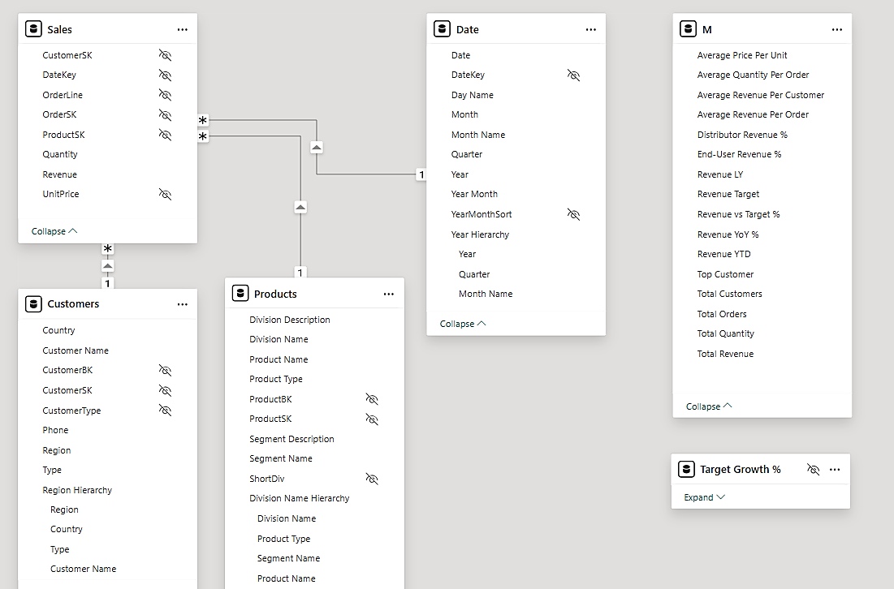
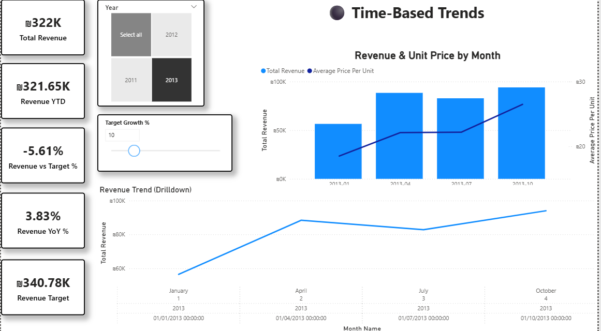
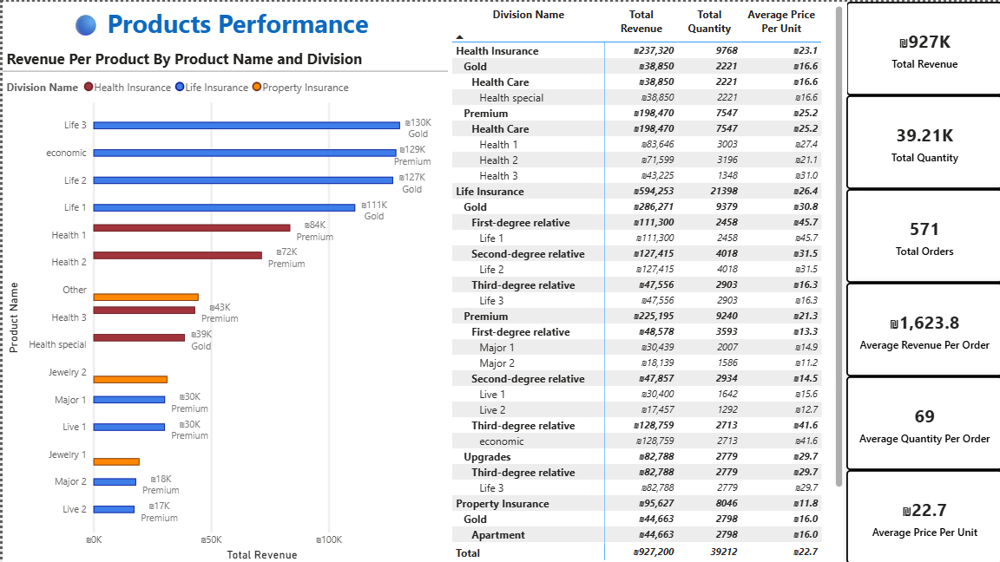
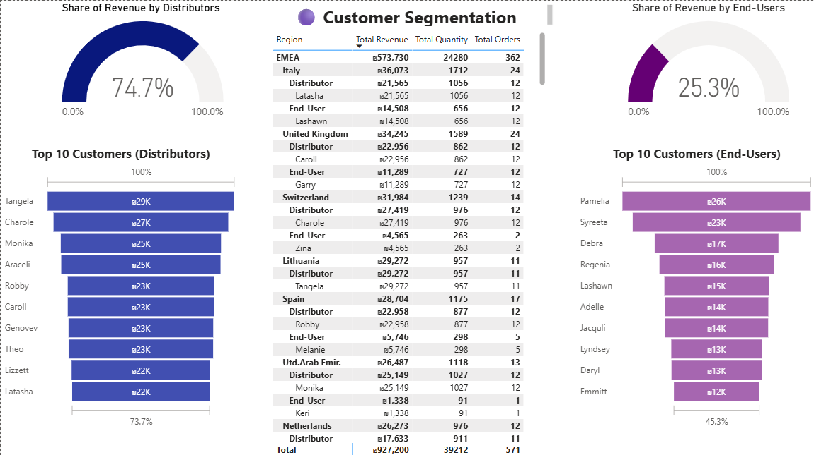
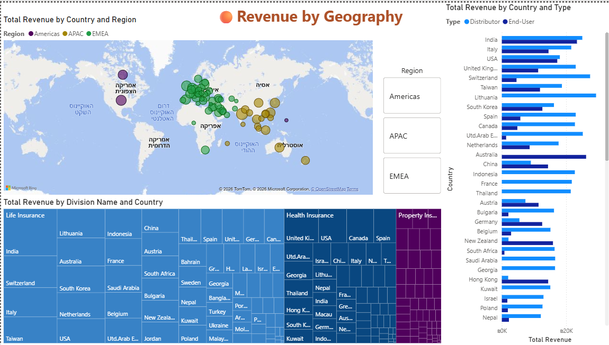

# Insurance Sales Analysis — Power BI Project

End-to-end BI project analyzing sales activity of a fictional insurance company **"Happy Insurance"** — from ETL in Power Query to a star schema data model, DAX measures, and interactive Power BI dashboards.

Team project — Technion Big Data Analyst program (TCBDA-28) · **Valeria Barabanova** · **Lihi Berg**

---

## Business Questions
- Which products, divisions and segments drive revenue?
- How does revenue develop over time, and are we meeting targets?
- Who are our customers (end-users vs. distributors) and how much does each segment spend?
- Which countries and regions generate the most revenue?

---

## Data Sources
| Source | Content |
|---|---|
| SQL Server | Transactional data — orders, order lines, products, customers |
| CSV file | Geographic and regional data |

The two sources are joined via a shared geographic key (`GeoKey`). The scope covers tens of thousands of records over three years of activity (2011–2013).

*The source SQL database and CSV are not included in this repository; the data is embedded in the `.pbix` file.*

---

## ETL Process (Power Query)
- **Data cleansing** — handling null values and outliers
- **Standardization** — data type conversions, consistent formats across sources
- **Merging queries** — combining SQL and CSV sources into dimension tables
- **Date dimension** — generated with parameters (`p_StartYear`, `p_EndYear`) and `List.Dates`
- **Custom function** `fn_QuarterKey` — builds a numeric quarter key (yyyyMMdd) from year and quarter
- **Surrogate keys** — index columns added to dimensions

---

## Data Model — Star Schema

| Table | Type | Description |
|---|---|---|
| `Sales` | Fact | Order lines with quantity, unit price and revenue |
| `Customers` | Dimension | Customer name, type, country, region (with region hierarchy) |
| `Products` | Dimension | Division, product type, segment (with product hierarchy) |
| `Date` | Dimension | Date, month, quarter, year (with date hierarchy) |
| `M` | Measures table | All DAX measures |

### Key DAX Measures
- **Revenue:** Total Revenue, Revenue YTD, Revenue LY, Revenue YoY %
- **Targets:** Revenue Target, Revenue vs Target % (with a What-If parameter *Target Growth %*)
- **Orders & customers:** Total Orders, Total Quantity, Total Customers, Top Customer
- **Averages:** Average Price Per Unit, Average Revenue Per Order, Average Revenue Per Customer, Average Quantity Per Order
- **Customer mix:** Distributor Revenue %, End-User Revenue %

---

## Dashboards
The report has four main pages plus two tooltip pages:

| Page | What it shows |
|---|---|
| ⚫ Time-Based Trends | Revenue and quantity trends over time, KPI cards, year and period slicers |
| 🔵 Products Performance | Revenue by division, product type and segment, with drill-down |
| 🟣 Customer Segmentation | End-users vs. distributors, revenue per customer type (funnels, gauges) |
| 🟠 Revenue by Geography | Revenue by country and region (map, treemap) |
| Tooltips | Customer profile and summary cards on hover |

### ⚫ Time-Based Trends

### 🔵 Products Performance

### 🟣 Customer Segmentation

### 🟠 Revenue by Geography

---

## Key Business Insights
**At a glance:** ₪927K total revenue · 571 orders · 39.2K units · ₪1,624 average revenue per order

1. **Revenue concentration** — **Life Insurance** generates ₪594K, about **64% of total revenue**, and the top markets are **India and Italy**. This creates exposure to regulatory or market changes in these countries → diversify revenue sources.
2. **Growth is driven by pricing, not just volume** — average price per unit improves consistently, especially in 2013, meaning more value is captured from each customer.
3. **Distributors drive the business** — distributors generate **74.7%** of revenue vs. 25.3% from end-users, so losing a few large distributors would have an outsized impact.
4. **2013 grew, but missed the growth target** — revenue grew **3.8% YoY** (₪321.7K vs ₪309.8K in 2012), while a +10% growth target (₪340.8K) was missed by **5.6%**. Targets should be based on current growth trends rather than historical data only (the *Target Growth %* What-If parameter lets you test different scenarios).

---

## Challenges
The main challenge was the initial ETL: combining a SQL database with an external CSV revealed differences in structure, date formats and granularity. Thorough cleaning and alignment were required so that DAX measures such as Revenue YoY and What-If scenarios would be calculated correctly.

---

## Tools Used
| Tool | Purpose |
|---|---|
| SQL Server | Source transactional data |
| Power Query | ETL and data transformation |
| Power Pivot (Excel) | Tabular model and initial dashboards |
| Power BI Desktop | Data model, DAX measures, interactive report |
| DAX | Time intelligence, KPIs, What-If analysis |

---

## Files
| File | Description |
|---|---|
| `AnalysisProject.pbix` | Power BI report (open with Power BI Desktop) |
| `PP-AnalysisProject.xlsx` | Power Pivot model with Excel dashboards (PivotTables & charts) |
| `Presentation-AnalysisProjectNew.pptx` | Project presentation (in Hebrew) |
| `images/data_model.png` | Star schema data model |
| `images/page*.png` | Dashboard screenshots |
